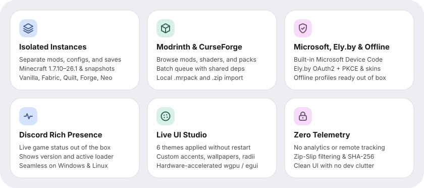
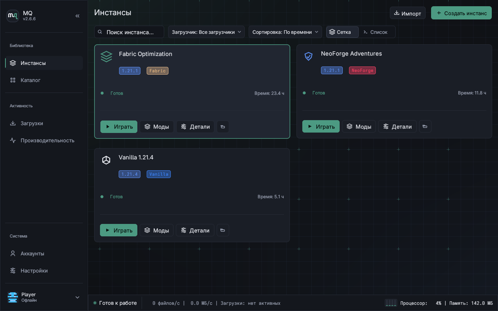
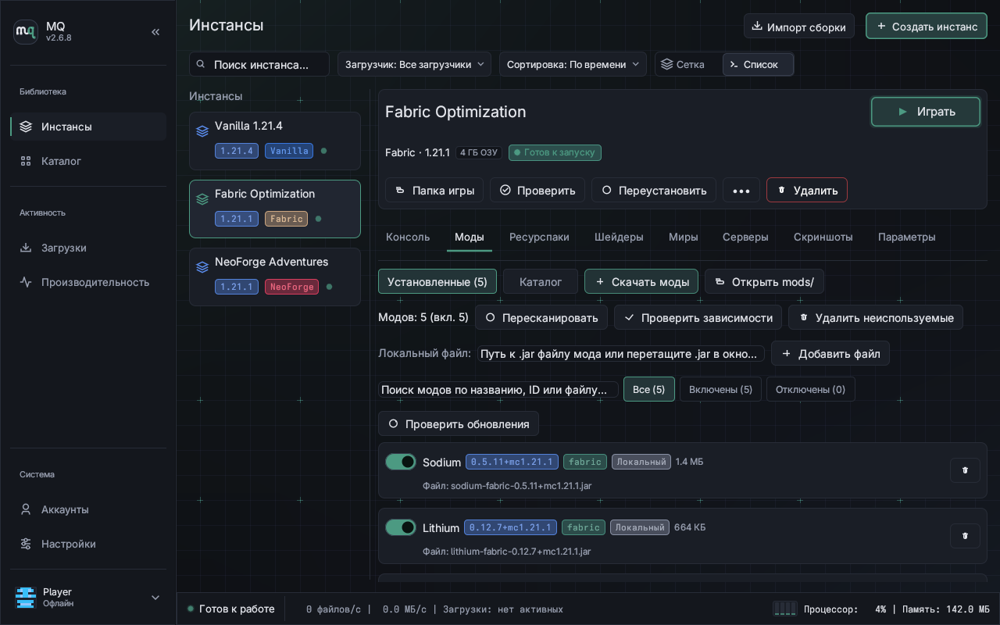
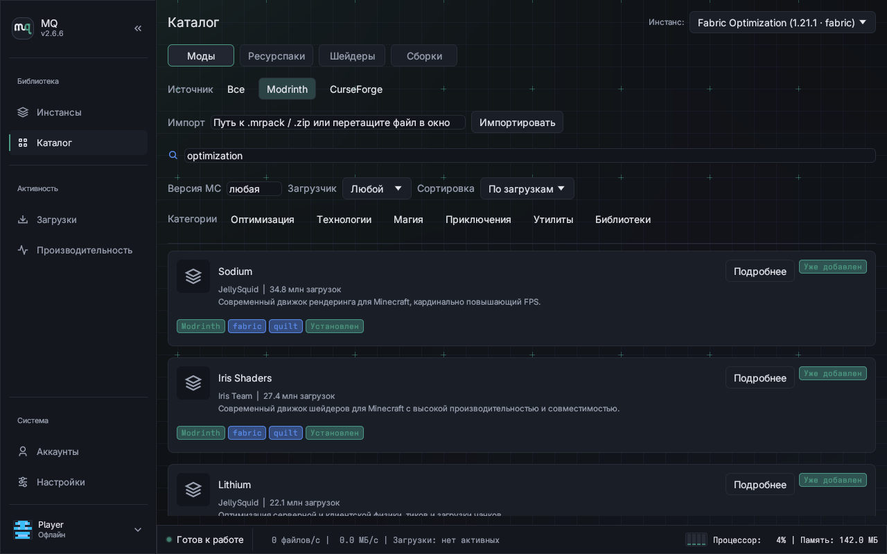
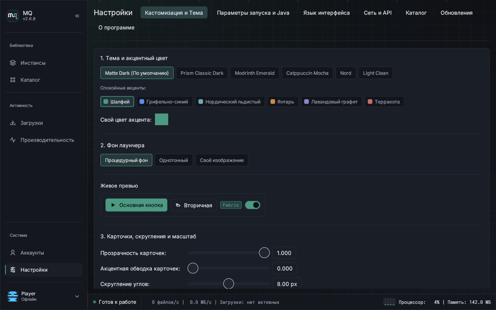
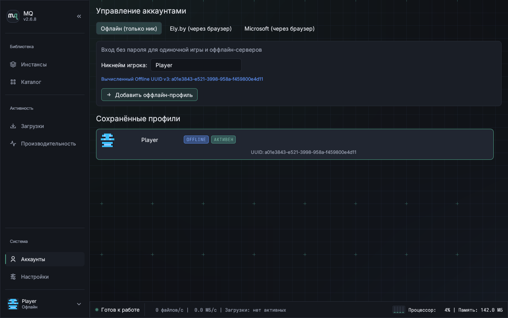
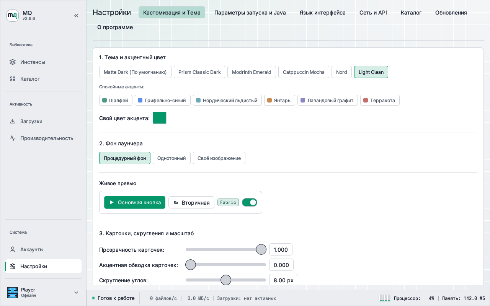
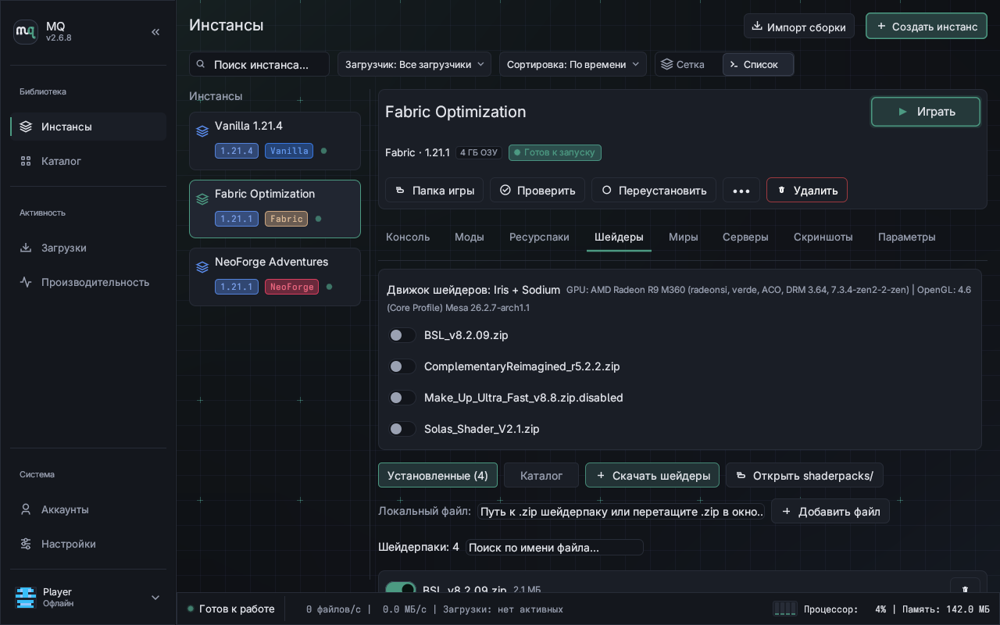
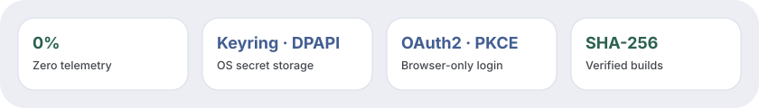

<div align="center">

<picture>
  <source media="(prefers-color-scheme: dark)" srcset="docs/assets/m3/hero-en-dark.svg">
  
</picture>

<br/><br/>

<a href="https://github.com/MrQuster/MQ-Launcher/releases/latest"><picture><source media="(prefers-color-scheme: dark)" srcset="docs/assets/m3/btn-download-en-dark.svg"></picture></a>&nbsp;&nbsp;<a href="#installation"><picture><source media="(prefers-color-scheme: dark)" srcset="docs/assets/m3/btn-install-en-dark.svg"></picture></a>&nbsp;&nbsp;<a href="#screenshots"><picture><source media="(prefers-color-scheme: dark)" srcset="docs/assets/m3/btn-screens-en-dark.svg"></picture></a>&nbsp;&nbsp;<a href="CHANGELOG.md"><picture><source media="(prefers-color-scheme: dark)" srcset="docs/assets/m3/btn-changelog-en-dark.svg"></picture></a>

<br/><br/>

[](https://github.com/MrQuster/MQ-Launcher/releases)
[](https://github.com/MrQuster/MQ-Launcher/releases)
[](https://github.com/MrQuster/MQ-Launcher/actions/workflows/ci.yml)
[](#installation)
[](#building-from-source)

[Русский](README.md) · **English**

<picture>
  <source media="(prefers-color-scheme: dark)" srcset="docs/assets/m3/wave-dark.svg">
  
</picture>

</div>

## Features

<div align="center">

<picture>
  <source media="(prefers-color-scheme: dark)" srcset="docs/assets/m3/features-en-dark.svg">
  
</picture>

</div>

- **Full Instance Isolation** — dedicated `mods/`, `resourcepacks/`, `shaderpacks/`, `config/`, and `saves/` folders per profile. Supports Minecraft `1.7.10` through `26.1` (`Releases`, `Snapshots`, `Beta`, `Alpha`), `Vanilla`, `Fabric`, `Quilt`, `Forge`, and `NeoForge` loaders, world backup/restore, and crash diagnostics.
- **Modrinth & CurseForge Catalog** — browse mods, resource packs, shaders, and modpacks, queue batches with automatic shared-dependency deduplication, import `.mrpack`/`.zip` files, and update or toggle installed content right inside each instance.
- **Zero-Friction Accounts** — Microsoft (OAuth2 Device Code Flow) and Ely.by (OAuth2 + PKCE S256 with `authlib-injector`) work out of the box with no manual client setup, alongside offline profiles with skin previews.

---

## Screenshots

<div align="center">

| Instances | Instance Mods |
| :---: | :---: |
|  |  |

| Catalog & Batch Queue | Theme Studio (Dark) |
| :---: | :---: |
|  |  |

| Accounts | Light Theme |
| :---: | :---: |
|  |  |

</div>

<details>
<summary>More screenshots: Shader management</summary>

<div align="center">



</div>

</details>

---

## Installation

Prebuilt binaries and `SHA256SUMS` checksums are published on [GitHub Releases](https://github.com/MrQuster/MQ-Launcher/releases/latest).

### Windows 10 / 11 (x64)

Quick one-line PowerShell installation:

```powershell
irm https://github.com/MrQuster/MQ-Launcher/releases/latest/download/install.ps1 | iex
```

Or download directly from Releases:
- **Installer:** `MQ-Setup-2.8.4-x64.exe`
- **Portable:** `mq-windows-x86_64-portable.zip` (`packaging/winget` and `packaging/scoop` manifests are also included)

> [!TIP]
> Placing `portable.flag` next to `mq.exe` keeps all instances, settings, and cache self-contained beside the executable.

### Linux (x86_64)

One-line installer with SHA-256 verification and desktop entry integration:

```bash
curl -fsSL https://github.com/MrQuster/MQ-Launcher/releases/latest/download/install.sh | sh
```

Standalone binaries (`mq-linux-x86_64`), tarballs (`mq-linux-x86_64.tar.gz`), and Arch packaging ([`packaging/PKGBUILD`](packaging/PKGBUILD)) are also available.

---

## Security & Privacy

<div align="center">

<picture>
  <source media="(prefers-color-scheme: dark)" srcset="docs/assets/m3/security-en-dark.svg">
  
</picture>

</div>

Further reading: [SECURITY.md](docs/SECURITY.md) · [PRIVACY.md](docs/PRIVACY.md) · [THREAT_MODEL.md](docs/THREAT_MODEL.md) · [FAQ.md](docs/FAQ.md)

---

## Building from Source

<details>
<summary>Developer instructions (Rust 1.80+)</summary>

Requires Rust toolchain `1.80+` (pinned in [`rust-toolchain.toml`](rust-toolchain.toml)).

```bash
# 1. Clone repository
git clone https://github.com/MrQuster/MQ-Launcher.git
cd MQ-Launcher

# 2. Run desktop UI
cargo run -p mq-cli -- ui

# 3. Build release binary
cargo build --release -p mq-cli

# 4. Run formatting, Clippy, and test suite
./scripts/verify.sh
```

The release binary is emitted at `target/release/mq` (`target\release\mq.exe` on Windows). Build dependencies and contributor guidelines are documented in [CONTRIBUTING.md](CONTRIBUTING.md).

</details>

---

<div align="center">

<picture>
  <source media="(prefers-color-scheme: dark)" srcset="docs/assets/m3/wave-dark.svg">
  
</picture>

</div>

MQ builds on open specifications and community tooling from [Modrinth](https://modrinth.com/), [Ely.by](https://ely.by/), [authlib-injector](https://github.com/yushijinhun/authlib-injector), [Fabric](https://fabricmc.net/), [Quilt](https://quiltmc.org/), and [NeoForge](https://neoforged.net/). Third-party crate licenses are listed in [THIRD_PARTY_LICENSES.md](THIRD_PARTY_LICENSES.md).

Author: [MrQuster](https://github.com/MrQuster). MQ Launcher is an independent open-source project and is not affiliated with or endorsed by Mojang Studios or Microsoft Corporation. Playing on servers with `online-mode=true` requires an official Minecraft account.
