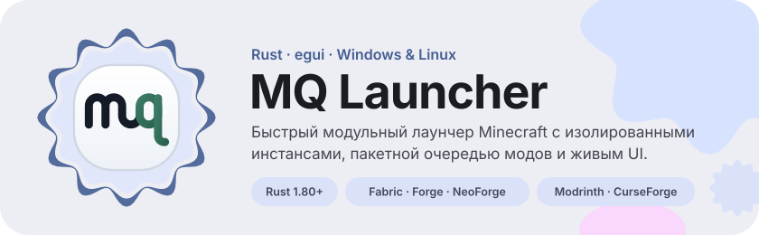
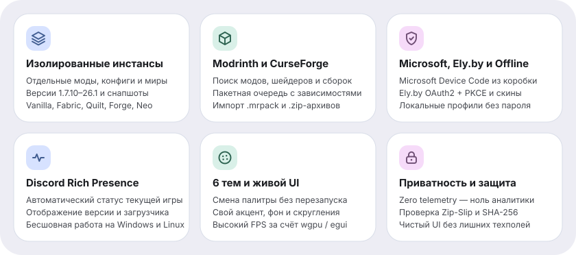
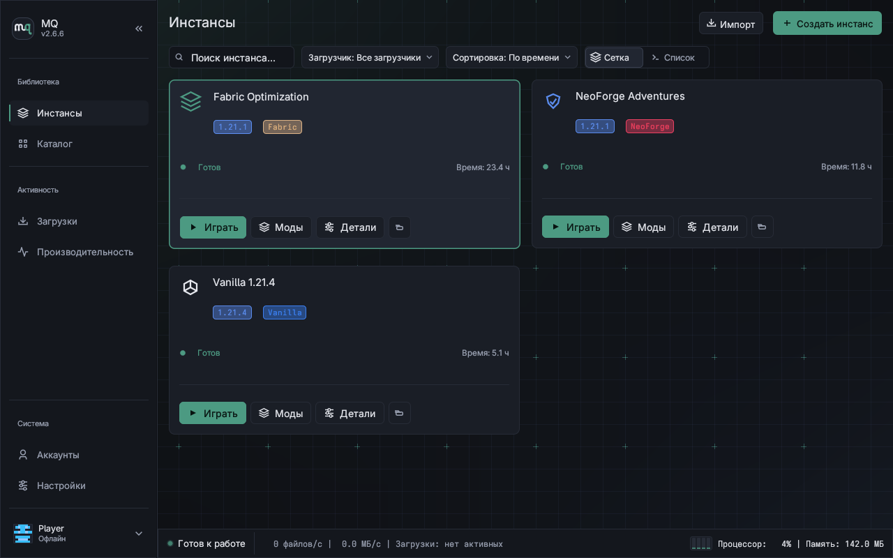
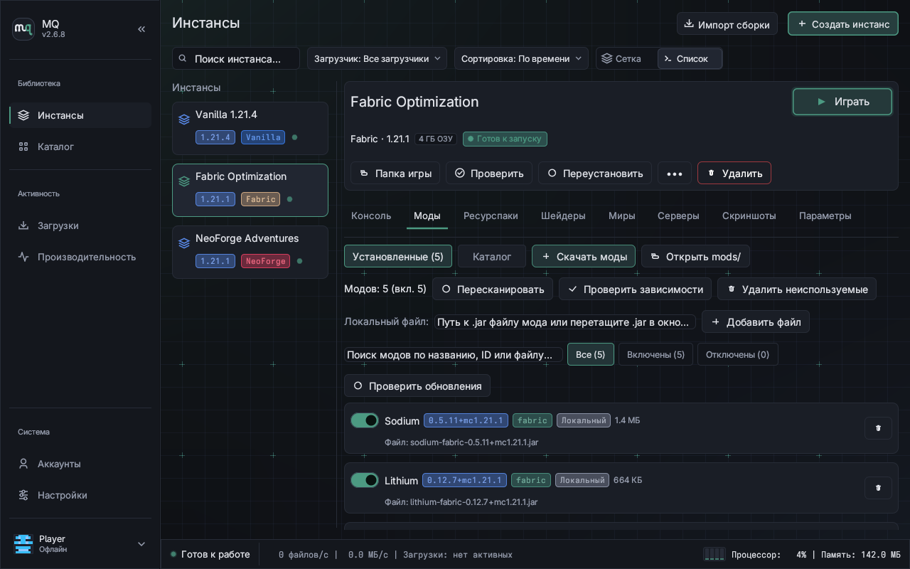
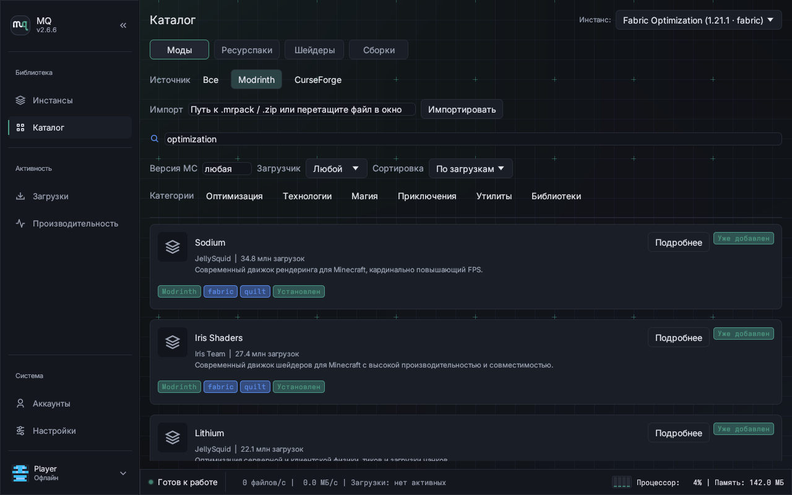
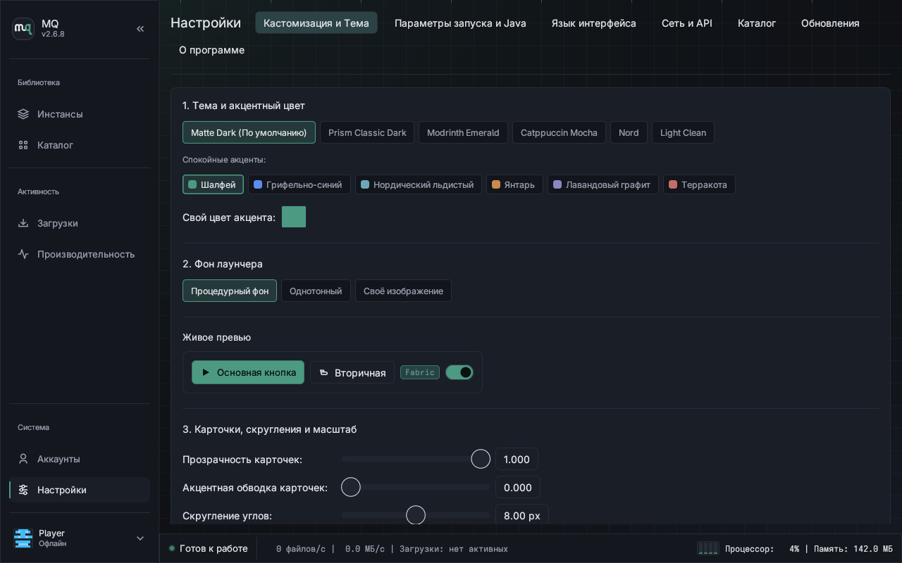
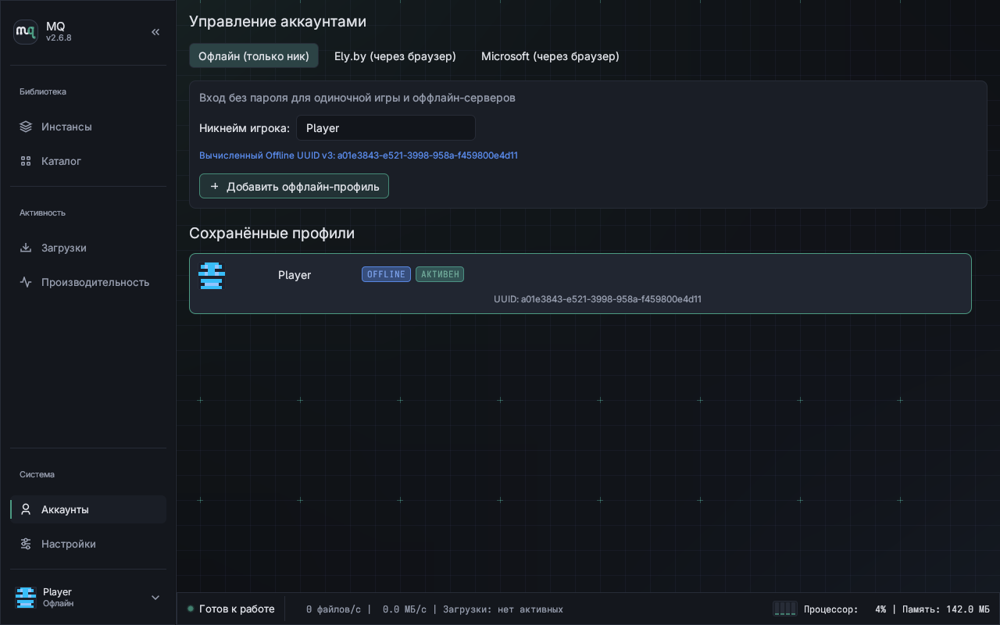
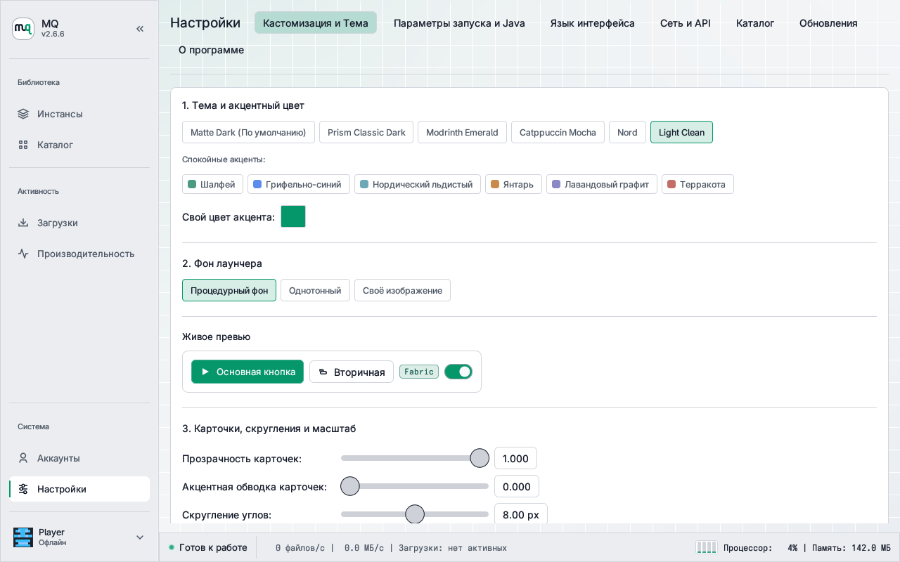
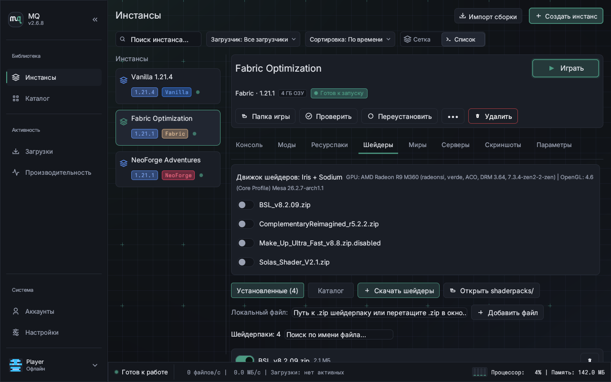
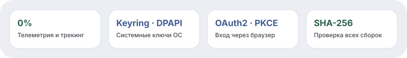

<div align="center">

<picture>
  <source media="(prefers-color-scheme: dark)" srcset="docs/assets/m3/hero-ru-dark.svg">
  
</picture>

<br/><br/>

<a href="https://github.com/MrQuster/MQ-Launcher/releases/latest"><picture><source media="(prefers-color-scheme: dark)" srcset="docs/assets/m3/btn-download-ru-dark.svg"></picture></a>&nbsp;&nbsp;<a href="#установка"><picture><source media="(prefers-color-scheme: dark)" srcset="docs/assets/m3/btn-install-ru-dark.svg"></picture></a>&nbsp;&nbsp;<a href="#скриншоты"><picture><source media="(prefers-color-scheme: dark)" srcset="docs/assets/m3/btn-screens-ru-dark.svg"></picture></a>&nbsp;&nbsp;<a href="CHANGELOG.md"><picture><source media="(prefers-color-scheme: dark)" srcset="docs/assets/m3/btn-changelog-ru-dark.svg"></picture></a>

<br/><br/>

[](https://github.com/MrQuster/MQ-Launcher/releases)
[](https://github.com/MrQuster/MQ-Launcher/releases)
[](https://github.com/MrQuster/MQ-Launcher/actions/workflows/ci.yml)
[](#установка)
[](#сборка-из-исходников)

**Русский** · [English](README.en.md)

<picture>
  <source media="(prefers-color-scheme: dark)" srcset="docs/assets/m3/wave-dark.svg">
  
</picture>

</div>

## Возможности

<div align="center">

<picture>
  <source media="(prefers-color-scheme: dark)" srcset="docs/assets/m3/features-ru-dark.svg">
  
</picture>

</div>

- **Изоляция сборок** — отдельные каталоги `mods/`, `resourcepacks/`, `shaderpacks/`, `config/` и `saves/` для каждого профиля, поддержка версий от `1.7.10` до `26.1` (`Релизы`, `Снапшоты`, `Beta`, `Alpha`), загрузчиков `Vanilla`, `Fabric`, `Quilt`, `Forge` и `NeoForge`, бэкапы миров и анализ крашей.
- **Каталог Modrinth и CurseForge** — поиск модов, ресурс-паков, шейдеров и модпаков, пакетная очередь с автоматической дедупликацией зависимостей, импорт `.mrpack`/`.zip`, проверка обновлений и управление уже установленными файлами прямо в инстансе.
- **Аккаунты без лишних настроек** — Microsoft (OAuth2 Device Code Flow) и Ely.by (OAuth2 + PKCE S256 с `authlib-injector`) работают сразу из коробки, плюс локальный офлайн-режим со скином.

---

## Скриншоты

<div align="center">

| Инстансы | Моды инстанса |
| :---: | :---: |
|  |  |

| Каталог модов и сборки | Оформление (тёмная тема) |
| :---: | :---: |
|  |  |

| Аккаунты | Светлая тема |
| :---: | :---: |
|  |  |

</div>

<details>
<summary>Ещё скриншот: управление шейдерами</summary>

<div align="center">



</div>

</details>

---

## Установка

Готовые сборки и контрольные суммы (`SHA256SUMS`) публикуются на странице [GitHub Releases](https://github.com/MrQuster/MQ-Launcher/releases/latest).

### Windows 10 / 11 (x64)

Быстрая установка одной командой в PowerShell:

```powershell
irm https://github.com/MrQuster/MQ-Launcher/releases/latest/download/install.ps1 | iex
```

Или выберите готовый артефакт в релизе:
- **Установщик:** `MQ-Setup-2.8.4-x64.exe`
- **Портативная версия:** `mq-windows-x86_64-portable.zip` (также доступны манифесты `packaging/winget` и `packaging/scoop`)

> [!TIP]
> Файл `portable.flag` рядом с `mq.exe` переводит лаунчер в полностью портативный режим: все инстансы, настройки и кэш хранятся в папке рядом с программой.

### Linux (x86_64)

Быстрая установка одной командой (загрузка релиза, проверка SHA-256 и интеграция с меню приложений):

```bash
curl -fsSL https://github.com/MrQuster/MQ-Launcher/releases/latest/download/install.sh | sh
```

Также доступны архив `mq-linux-x86_64.tar.gz`, standalone-бинарник `mq-linux-x86_64` и рецепт для Arch Linux в [`packaging/PKGBUILD`](packaging/PKGBUILD).

---

## Безопасность и приватность

<div align="center">

<picture>
  <source media="(prefers-color-scheme: dark)" srcset="docs/assets/m3/security-ru-dark.svg">
  
</picture>

</div>

Подробная документация: [SECURITY.md](docs/SECURITY.md) · [PRIVACY.md](docs/PRIVACY.md) · [THREAT_MODEL.md](docs/THREAT_MODEL.md) · [FAQ.md](docs/FAQ.md)

---

## Сборка из исходников

<details>
<summary>Инструкция для разработчиков (Rust 1.80+)</summary>

Требуется инструментарий Rust (`1.80+`, зафиксирован в [`rust-toolchain.toml`](rust-toolchain.toml)).

```bash
# 1. Клонирование репозитория
git clone https://github.com/MrQuster/MQ-Launcher.git
cd MQ-Launcher

# 2. Запуск GUI из исходников
cargo run -p mq-cli -- ui

# 3. Релизная сборка
cargo build --release -p mq-cli

# 4. Проверка форматирования, Clippy и тестов
./scripts/verify.sh
```

Исполняемый файл собирается в `target/release/mq` (`target\release\mq.exe` на Windows). Зависимости сборки и правила контрибьюта описаны в [CONTRIBUTING.md](CONTRIBUTING.md).

</details>

---

<div align="center">

<picture>
  <source media="(prefers-color-scheme: dark)" srcset="docs/assets/m3/wave-dark.svg">
  
</picture>

</div>

MQ использует открытые спецификации и инструменты сообщества: [Modrinth](https://modrinth.com/), [Ely.by](https://ely.by/), [authlib-injector](https://github.com/yushijinhun/authlib-injector), [Fabric](https://fabricmc.net/), [Quilt](https://quiltmc.org/) и [NeoForge](https://neoforged.net/). Лицензии библиотек перечислены в [THIRD_PARTY_LICENSES.md](THIRD_PARTY_LICENSES.md).

Автор: [MrQuster](https://github.com/MrQuster). MQ Launcher является независимым проектом с открытым исходным кодом и не связан с Mojang Studios или Microsoft Corporation. Для игры на серверах с `online-mode=true` требуется лицензионный аккаунт Minecraft.
